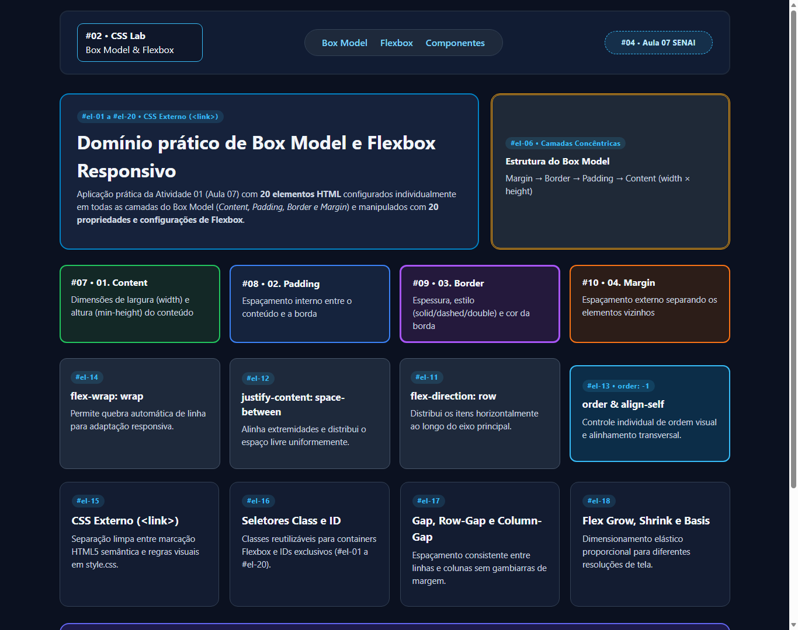

# 🎨 CSS Lab — Box Model (20 Elementos) & Flexbox Responsivo

Projeto prático desenvolvido para atender integralmente à **Atividade 01 da Aula 07 (Frameworks CSS)** da disciplina de **Frameworks Front-end** (SENAI).

---

## 📸 Captura de Tela da Aplicação em Funcionamento



---

## 🎯 Requisitos Atendidos (Aula 07 — Atividade 01)

1. Estrutura com `index.html` e `style.css` vinculado de forma **Externa** através da tag `<link rel="stylesheet" href="style.css" />`;
2. **20 elementos HTML distintos** (`#el-01` a `#el-20`), cada um configurado explicitamente com propriedades de **Content** (`width` e `min-height`), **Padding**, **Border** e **Margin**;
3. **20 propriedades e configurações de Flexbox** aplicadas para manipular e organizar os elementos de maneira responsiva em desktop, tablet e celular.

---

## 🛠️ Tecnologias Utilizadas

- HTML5 Semântico
- CSS3 Externo (`<link>`)
- CSS Box Model (*Content*, *Padding*, *Border*, *Margin*)
- CSS Flexbox & Media Queries Responsivas

---

## 📁 Estrutura de Diretórios

```text
projeto-css-flexbox/
├── docs/
│   └── screenshot-css-flexbox.png
├── index.html          # 20 elementos semânticos identificados (#el-01 a #el-20)
├── style.css           # Regras externas de Box Model e 20 propriedades Flexbox
├── .gitignore
└── README.md
```

---

## 📦 Mapeamento dos 20 Elementos (Box Model)

| # | ID | Função na Interface | Content (`width` / `min-height`) | Padding | Border | Margin |
|---|---|---|---|---|---|---|
| 01 | `#el-01` | Cabeçalho principal | `calc(100% - 32px)` / `78px` | `16px 24px` | `2px solid #1e293b` | `18px auto 24px auto` |
| 02 | `#el-02` | Bloco da marca | `215px` / `54px` | `8px 14px` | `1px solid #38bdf8` | `4px` |
| 03 | `#el-03` | Menu de navegação | `340px` / `46px` | `10px 18px` | `1px solid #334155` | `4px 8px` |
| 04 | `#el-04` | Selo institucional | `185px` / `40px` | `8px 12px` | `1px dashed #38bdf8` | `4px` |
| 05 | `#el-05` | Painel Hero principal | `100%` / `190px` | `24px 28px` | `2px solid #0284c7` | `8px 0 20px 0` |
| 06 | `#el-06` | Diagrama do Box Model | `100%` / `190px` | `24px 22px` (*longhand*) | `3px double #f59e0b` | `8px 0 20px 0` |
| 07 | `#el-07` | Card camada Content | `220px` / `112px` | `16px 18px` | `2px solid #22c55e` | `6px 0 20px 0` |
| 08 | `#el-08` | Card camada Padding | `220px` / `112px` | `18px 20px` | `2px solid #3b82f6` | `6px 0 20px 0` |
| 09 | `#el-09` | Card camada Border | `220px` / `112px` | `16px 20px` | `3px solid #a855f7` | `6px 0 20px 0` |
| 10 | `#el-10` | Card camada Margin | `220px` / `112px` | `16px 20px` | `2px solid #f97316` | `6px 0 20px 0` |
| 11 | `#el-11` | Demo `flex-direction` | `240px` / `150px` | `18px` | `1px solid #475569` | `6px 0 18px 0` |
| 12 | `#el-12` | Demo `justify-content` | `240px` / `150px` | `20px` | `1px solid #475569` | `6px 0 18px 0` |
| 13 | `#el-13` | Demo `order` & `align-self` | `240px` / `150px` | `20px` | `2px solid #38bdf8` | `6px 0 18px 0` |
| 14 | `#el-14` | Demo `flex-wrap` | `240px` / `150px` | `18px` | `1px solid #475569` | `6px 0 18px 0` |
| 15 | `#el-15` | Card CSS Externo | `250px` / `145px` | `18px 20px` | `1px solid #334155` | `4px 0 18px 0` |
| 16 | `#el-16` | Card Class e ID | `250px` / `145px` | `18px 20px` | `1px solid #334155` | `4px 0 18px 0` |
| 17 | `#el-17` | Card Gap | `250px` / `145px` | `18px 20px` | `1px solid #334155` | `4px 0 18px 0` |
| 18 | `#el-18` | Card Flex Grow/Basis | `250px` / `145px` | `18px 20px` | `1px solid #334155` | `4px 0 18px 0` |
| 19 | `#el-19` | Banner de Responsividade | `100%` / `125px` | `24px 28px` | `2px solid #6366f1` | `10px 0 28px 0` |
| 20 | `#el-20` | Rodapé institucional | `calc(100% - 32px)` / `68px` | `16px 24px` | `1px solid #1e293b` | `8px auto 28px auto` |

---

## 📐 20 Propriedades e Configurações de Flexbox Aplicadas

1. `display: flex` (`.cabecalho-flex`, `.hero-flex`, `.metricas-flex`)
2. `display: inline-flex` (`.marca-box`)
3. `flex-direction: row` (`.cabecalho-flex`)
4. `flex-direction: column` (`.marca-box`, `.diagrama-boxmodel` e mobile)
5. `flex-direction: row-reverse` (`.galeria-flex`)
6. `flex-wrap: wrap` (`.cabecalho-flex`, `.metricas-flex`, `.grade-cartoes-flex`)
7. `flex-wrap: nowrap` (`.menu-flex`)
8. `flex-flow: row wrap` (`.hero-flex`)
9. `justify-content: space-between` (`.cabecalho-flex`, `.rodape-flex`)
10. `justify-content: center` (`.menu-flex`, `.cta-flex`)
11. `justify-content: space-around` (`.galeria-flex`)
12. `justify-content: space-evenly` (`.metricas-flex`)
13. `align-items: center` (`.cabecalho-flex`, `.cta-flex`)
14. `align-items: stretch` (`.hero-flex`, `.grade-cartoes-flex`)
15. `align-items: flex-start` (`.marca-box`, `.diagrama-boxmodel`)
16. `align-content: space-between` (`.galeria-flex`)
17. `gap`, `row-gap` e `column-gap` (`.cabecalho-flex`, `.menu-flex`, `.metricas-flex`)
18. `flex-grow`, `flex-shrink`, `flex-basis` e shorthand `flex` (`.cartao-conceito`, `#el-05`, `#el-06`)
19. `align-self: center` (`.destaque-ordem`)
20. `order: -1` (`.destaque-ordem`)

---

## 🚀 Instruções de Instalação e Execução

```bash
git clone https://github.com/Enzootomas/projeto-css-flexbox.git
cd projeto-css-flexbox
```

Abra o arquivo `index.html` diretamente no navegador ou utilize a extensão **Live Server** no Visual Studio Code.

---

## 🎓 Disciplina

**Frameworks Front-end** — Curso Superior de Tecnologia em Análise e Desenvolvimento de Sistemas (SENAI)  
**Professor:** Me. Deivison S. Takatu
